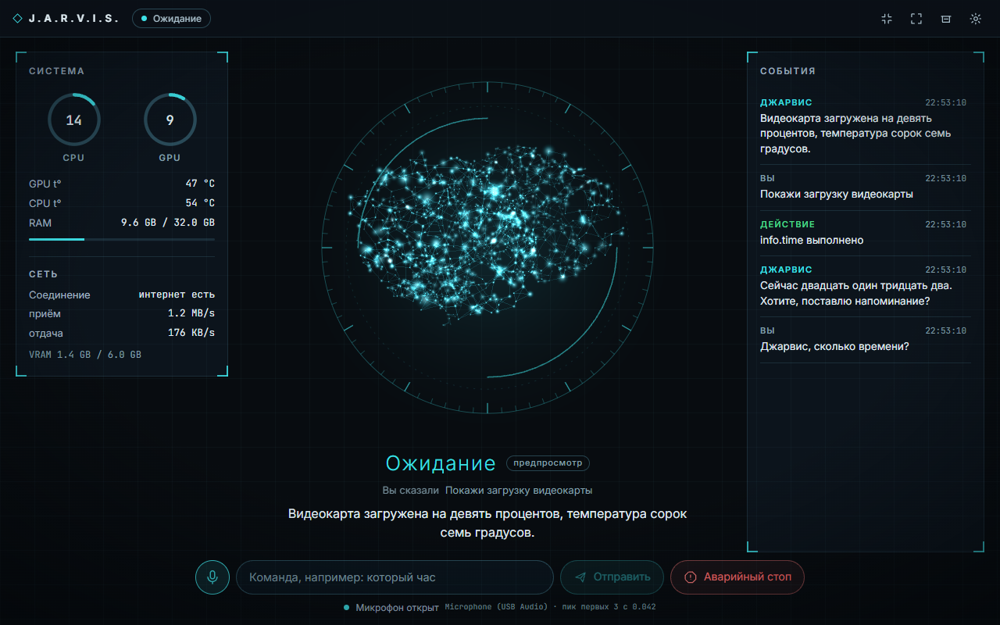
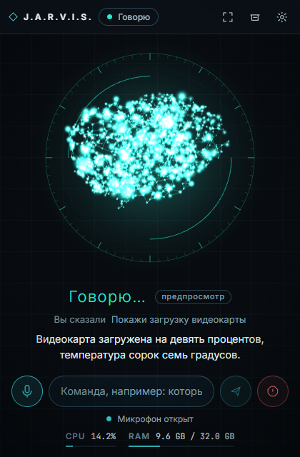
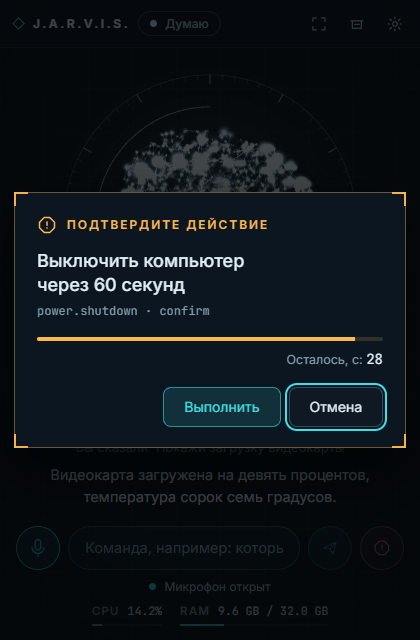
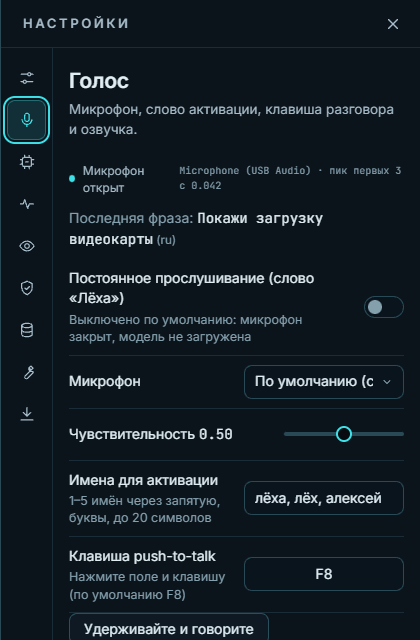

# J.A.R.V.I.S.

**Русский** | [English](#english)

Локальный голосовой ассистент для Windows 11: слушает имя-активатор, распознаёт речь, выполняет команды управления компьютером и отвечает голосом.
Всё работает на вашем компьютере, облачные сервисы по умолчанию выключены.

> Фан-проект. Не связан с Marvel, Disney и их правообладателями; название «J.A.R.V.I.S.» используется как дань уважения.



| Говорит | Подтверждение действия | Настройки |
|---|---|---|
|  |  |  |

Скриншоты сделаны на демонстрационных данных.

## Возможности

- Постоянное прослушивание имени-активатора (Rust: RNNoise, VAD, Vosk small-ru); микрофон выключен, пока вы не включили прослушивание. Есть push-to-talk (`F8`).
- Распознавание речи ru/en (faster-whisper, GPU по возможности) и синтез речи (Piper для русского, Kokoro для английского).
- Быстрые команды без LLM: приложения, окна, громкость, файлы (удаление только в корзину), процессы, сеть, питание. Опасные действия требуют подтверждения.
- Необязательный локальный «мозг» через Ollama: понимание свободных фраз, память о фактах, защита от prompt injection.
- HUD-интерфейс: 3D-нейросеть, реагирующая на состояние и голос, системные метрики, журнал действий. Живёт в трее, окно создаётся по требованию.
- Малое потребление: в трее около 9 МБ памяти и ~0% CPU; Python запускается только по требованию.

## Требования

- Windows 11 x64, микрофон.
- GPU необязателен (ускоряет распознавание речи и графику).
- [Ollama](https://ollama.com) необязателен (для понимания свободных фраз); модели скачиваются вами.
- Первый запуск: мастер во вкладке SETUP скачивает модели с проверкой SHA256 (около 1 ГБ в сумме).

## Установка

Скачайте `JARVIS-Assistant_<версия>_x64-setup.exe` со страницы [Releases](../../releases) и запустите. Права администратора не нужны, язык установщика (русский/английский) выбирается при запуске. Подробности — в `CHANGELOG.md`.

## Сборка из исходников

Нужны Rust (stable, MSVC), Node.js 20+, [uv](https://docs.astral.sh/uv/), PowerShell.

```powershell
powershell -ExecutionPolicy Bypass -File scripts\fetch-models.ps1   # libvosk и модель Vosk (для сборки и тестов)
powershell -ExecutionPolicy Bypass -File scripts\check.ps1          # npm + fmt + clippy + тесты + воркеры
powershell -ExecutionPolicy Bypass -File scripts\build-installer.ps1   # установщик в target\release\bundle\nsis
```

Разработка: `cd app; npm ci; npx tauri dev` (подробности — `docs/DEVELOPMENT.md`). Укажите `JARVIS_DATA_DIR` на временную папку, чтобы не затрагивать свои настройки. См. `CONTRIBUTING.md`.

## Приватность

Аудио не покидает компьютер и не пишется на диск. Распознавание, синтез и языковая модель работают локально; облачные функции выключены по умолчанию и включаются явно.
Данные (настройки, память, журнал) лежат в `%APPDATA%\Jarvis`, модели — в `%LOCALAPPDATA%\Jarvis`. Деинсталлятор спрашивает, удалять ли их. Модель угроз — `docs/SECURITY.md`.

## Архитектура кратко

Постоянный процесс — только Rust: ядро `jarvis-core` (шина событий, SQLite, супервизор) встроено в Tauri 2 приложение `jarvis.exe`; крейты `jarvis-voice`, `jarvis-control`, `jarvis-brain`, `jarvis-tts`, `jarvis-sysintel`, `jarvis-vision`.
UI — React + three.js. Python-воркеры (`workers/stt`, `workers/tts_kokoro`) стартуют по требованию и выходят после простоя, общение — бинарные кадры по stdin/stdout. Подробнее: `ARCHITECTURE.md`, `API_CONTRACTS.md`, `docs/PERFORMANCE.md`.

## Лицензия

Apache-2.0, см. `LICENSE`. Сторонние компоненты и модели — в `NOTICE`.

---

## English

A local voice assistant for Windows 11: it listens for a wake name, transcribes speech, runs computer-control commands and answers by voice.
Everything runs on your machine; cloud services are off by default.

> Fan project. Not affiliated with Marvel, Disney or their rights holders; the name "J.A.R.V.I.S." is used as a tribute.

### Features

- Always-on wake-name listening in Rust (RNNoise, VAD, Vosk small-ru); the microphone stays closed until you enable listening. Push-to-talk (`F8`).
- Speech recognition ru/en (faster-whisper, GPU when available) and speech synthesis (Piper for Russian, Kokoro for English).
- Fast commands without an LLM: apps, windows, volume, files (delete goes to the recycle bin only), processes, network, power. Risky actions need confirmation.
- Optional local "brain" through Ollama: free-form requests, fact memory, prompt-injection guard.
- HUD interface: a 3D neural core reacting to state and voice, system metrics, action log. Lives in the tray; the window is created on demand.
- Light footprint: about 9 MB in the tray with ~0% CPU; Python starts only on demand.

### Requirements

Windows 11 x64 and a microphone. A GPU is optional. [Ollama](https://ollama.com) is optional. On first run the SETUP tab downloads the models (about 1 GB, SHA256-verified).

### Install

Download `JARVIS-Assistant_<version>_x64-setup.exe` from [Releases](../../releases) and run it. No administrator rights are needed; the installer asks for English or Russian at start.

### Build from source

Requires Rust (stable, MSVC), Node.js 20+, [uv](https://docs.astral.sh/uv/) and PowerShell.

```powershell
powershell -ExecutionPolicy Bypass -File scripts\fetch-models.ps1
powershell -ExecutionPolicy Bypass -File scripts\check.ps1
powershell -ExecutionPolicy Bypass -File scripts\build-installer.ps1
```

For development: `cd app; npm ci; npx tauri dev`, with `JARVIS_DATA_DIR` pointing to a scratch folder. See `CONTRIBUTING.md`.

### Privacy

Audio never leaves your computer and is never written to disk. Recognition, synthesis and the language model run locally; cloud features are off by default and opt-in.
Data lives in `%APPDATA%\Jarvis` and models in `%LOCALAPPDATA%\Jarvis`; the uninstaller asks whether to remove them. Threat model: `docs/SECURITY.md`.

### Architecture

The only always-on process is Rust: the `jarvis-core` core (event bus, SQLite, supervisor) is embedded in the Tauri 2 app `jarvis.exe`, with crates for voice, control, brain, TTS, system info and vision.
The UI is React + three.js. Python workers start on demand and exit when idle, speaking binary frames over stdin/stdout. See `ARCHITECTURE.md` and `API_CONTRACTS.md`.

### License

Apache-2.0 (see `LICENSE`). Third-party components and models: see `NOTICE`.
